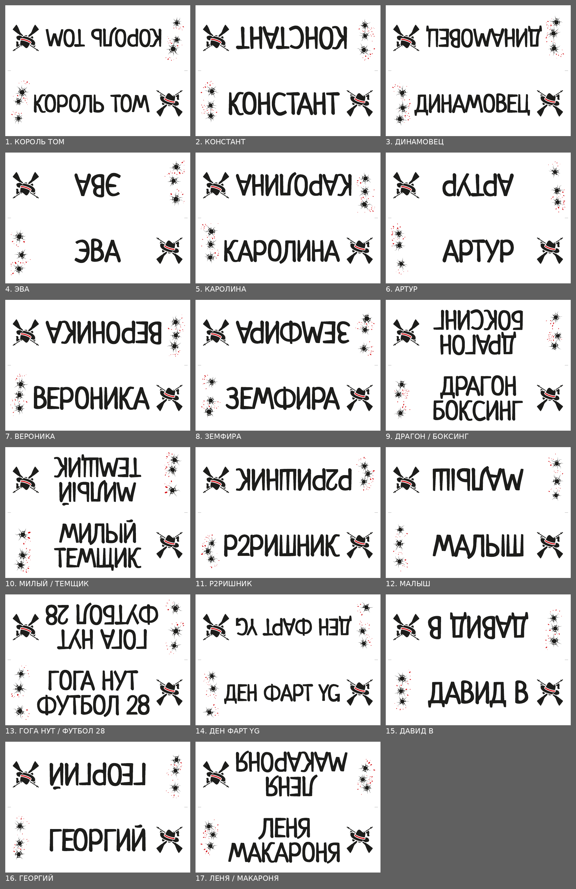

# Таблички для мафии — генератор

Таблички-«домики» с никами игроков: лист A4 складывается **вдоль** пополам, получаются две
стороны по 297×105 мм. Ник напечатан на обеих половинах, верхняя — вверх ногами, поэтому
после сгиба он читается с обеих сторон стола.

Оформление: крупный ник «маркером», слева пулевые отверстия с красными брызгами, справа
эмблема — шляпа-федора на двух скрещённых томми-ганах.



## Готовые файлы (`output/`)

| Файл | Для чего |
|---|---|
| `mafia_tablichki_print_FOGRA39.pdf` | **Для типографии.** A4 + вылеты 3 мм, только CMYK, профиль Coated FOGRA39 встроен, текст в кривых, PDF/X-1a:2003 |
| `mafia_tablichki_A4_office.pdf` | **Для офисного принтера.** Ровно A4, без вылетов, с серыми метками сгиба по краям |
| `mafia_tablichka_pustaya_print_FOGRA39.pdf` | **Пустая табличка для типографии**: эмблема и пулевые отверстия, место под ник пустое — дописать маркером |
| `mafia_tablichka_pustaya_A4_office.pdf` | Пустая табличка для офисного принтера |
| `mafia_tablichki_preview.pdf` | **Предпросмотр, чтобы показать**: по табличке на странице, только лицевая сторона (без перевёрнутой половины), пустая — последней. Не для печати |
| `preview/contact_sheet.png` | Превью всех табличек (экранная цветопроба по FOGRA39) |
| `preview/tent_view.png` | Как выглядят обе стороны сложенной таблички |
| `preview/fonts_comparison.png` | Сравнение шрифтов-кандидатов |

### Печать в типографии
- Отдайте `mafia_tablichki_print_FOGRA39.pdf`: 17 страниц, по одному листу A4 на игрока,
  печать односторонняя (4+0).
- FOGRA39 — стандарт офсетной печати на **мелованной** бумаге. Для немелованной бумаги
  типография может попросить другой профиль, уточните.
- Чтобы «домик» стоял, обычно берут плотную бумагу (около 250–300 г/м²). Попросите
  **биговку** (продавливание линии сгиба) посередине, в 105 мм от длинного края:
  без неё плотная бумага трескается на сгибе.
- Попросите типографию прогнать файл через свою проверку (preflight). Формально проверить
  PDF/X без Acrobat Pro или аналога нельзя, см. «Что проверяет генератор».

### Печать на офисном принтере
- Печатайте `mafia_tablichki_A4_office.pdf` в масштабе **100%** («Фактический размер»),
  без «Подогнать по размеру страницы».
- Возьмите самую плотную бумагу, которую берёт ваш принтер (см. его характеристики).

### Как сложить
Напечатанной стороной наружу, по линии между серыми метками (офисный файл) или по
биговке. Верхняя половина перевёрнута специально, так и должно быть.

### Пустая табличка
Отдельный файл на один лист: закажите или напечатайте столько копий, сколько нужно
запасных табличек. Ник пишется маркером в пустой середине, на обеих сторонах. Удобнее
писать на уже сложенном «домике»: на плоском листе одна половина перевёрнута.
Пулевые отверстия на всех копиях пустой таблички одинаковые (на именных — разные).

Маркер: на глянцевой мелованной бумаге водный маркер может размазываться и долго
сохнуть. Надёжнее перманентный (спиртовой) маркер или матовая мелованная бумага.
Проверьте на одном листе заранее.

### Предпросмотр
`mafia_tablichki_preview.pdf` — чтобы показать таблички, например переслать в чат:
по одной табличке на странице, только сторона, которую видно за столом. Файл векторный,
чёткий при любом увеличении. Цвета переведены в RGB для экрана по профилю FOGRA39
(экранная цветопроба), поэтому **в типографию его не отправляйте**: для печати — файлы
с `print` в названии.

## Как поменять ники и пересобрать

1. Отредактируйте `names.txt`: один ник на строку, регистр не важен. Символ `|` задаёт
   перенос строки вручную, например `гога нут|футбол 28`.
2. Нужен Python 3.11+ и библиотеки:
   ```bash
   pip install -r requirements.txt
   python -m cards
   ```
3. Файлы появятся в `output/`: основные таблички, пустая табличка и предпросмотр.
   В консоли будет отчёт: как разбит каждый ник, какой высоты буквы, результаты проверок.

Параметры запуска:

| Параметр | Что делает |
|---|---|
| `--names файл.txt` | другой список ников |
| `--style файл.toml` | другие настройки |
| `--out папка` | куда сохранять |
| `--icc профиль.icc` | встроить свой профиль печати (например, присланный типографией) |
| `--no-icc` | не встраивать профиль, указать только условие печати FOGRA39 |
| `--no-preview` | не делать PNG-превью (они требуют утилиту `pdftoppm` из poppler) |
| `--verify файл.pdf` | только проверить готовый PDF |

При первом запуске генератор сам скачивает профиль Coated FOGRA39 с сайта Adobe и
проверяет его контрольную сумму. Профиль кешируется в `.cache/icc/`, в репозиторий не
попадает (см. «Лицензии»). Если скачать не удалось, PDF всё равно собирается: условие
печати FOGRA39 указывается по имени, для PDF/X-1a это допустимо.

## Настройки (`style.toml`)

Все размеры в миллиметрах, цвета — CMYK в процентах. Главное:

- `[colors]`: `black = [0, 0, 0, 100]` (чистый K, без цветной каймы при несовмещении) и
  красный акцент `red = [0, 100, 100, 10]`.
- `[name]`: шрифт (`font`, любой TTF/OTF с кириллицей; для вариативных шрифтов —
  `variations`), утолщение букв `embolden`, предельная высота букв `max_cap`, правило
  переноса на две строки (`one_line_min_cap`) и зона ника `box`.
- `[emblem]`, `[holes]`: положение и размеры эмблемы и пулевых отверстий; `enabled = false`
  отключает элемент.

Безопасные отступы — 8 мм от краёв листа и от линии сгиба. Красный нигде не касается
чёрного: у ленты шляпы и у брызг есть белый зазор, поэтому при неточном совмещении
красок не появятся белые щели.

## Что проверяет генератор

После сборки каждый PDF проверяется (`cards/verify.py`):
- PDF 1.4, `/ID`, Info с `GTS_PDFXVersion = PDF/X-1a:2003` и `Trapped = False`;
- одна OutputIntent `GTS_PDFX` с `FOGRA39` / `http://www.color.org`; встроенный профиль —
  CMYK-профиль печати ICC v2;
- MediaBox = BleedBox = A4 + 3 мм, TrimBox = A4;
- в файле нет шрифтов, картинок, прозрачности, аннотаций, RGB: в потоках страниц только
  контуры и цвета из палитры;
- вся краска внутри безопасных зон обеих сторон;
- по растру: лист совпадает сам с собой при повороте на 180°, то есть верхняя половина
  действительно перевёрнутая копия нижней.
- предпросмотр: по одной стороне на странице (297×105 мм), только RGB-цвета палитры.

**Не проверяется:** формальное соответствие ISO 15930-4 (PDF/X-1a). Для этого нужен
Acrobat Pro (Preflight), callas pdfToolbox или Enfocus PitStop; у типографий они обычно есть.

Тесты: `pip install pytest && python -m pytest`.

## Лицензии

- Шрифт **Neucha** — Jovanny Lemonad, SIL Open Font License 1.1 (`assets/fonts/OFL.txt`).
  Печатать и переводить в кривые можно.
- Иконки шляпы и автомата — **Lorc** и **Skoll**, [game-icons.net](https://game-icons.net),
  CC BY 3.0: авторов нужно указывать (`assets/icons/ATTRIBUTION.md`, также в свойствах PDF).
- Профиль **Coated FOGRA39 (ISO 12647-2:2004)** — Adobe. Лицензия Adobe разрешает
  распространять профиль встроенным в файлы (поэтому он есть внутри PDF) или отдельно,
  но не вместе с программой. Поэтому генератор скачивает его при сборке.
- Пулевые отверстия и брызги рисует код генератора.

## Устройство

```
cards/
  config.py   names.txt + style.toml
  text.py     набор текста и контуры глифов (HarfBuzz)
  layout.py   раскладка стороны: ник (1–2 строки), эмблема, отверстия
  icons.py    SVG-иконки и пулевые отверстия
  pdf.py      потоки страниц и сборка PDF (pypdf)
  assets.py   загрузка ICC-профиля
  verify.py   проверки
  preview.py  PNG-превью
assets/       шрифт, иконки, лицензии
tests/        pytest
```
